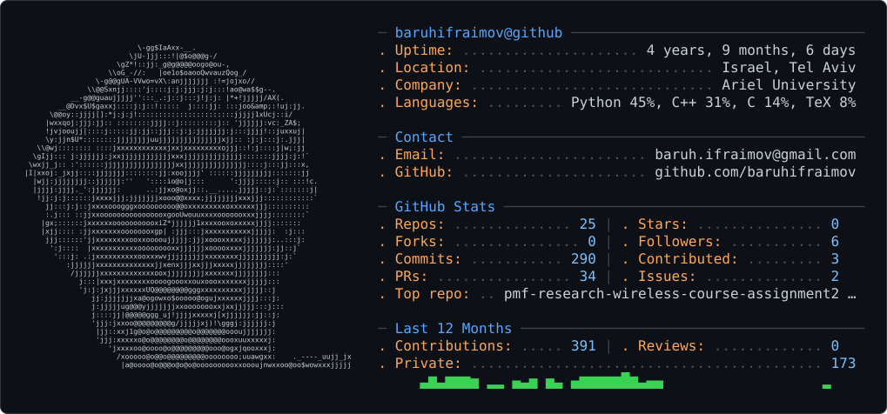

<picture>
  <source
    media="(prefers-color-scheme: dark)"
    srcset="asset/dark_mode.svg"
  />
  <source
    media="(prefers-color-scheme: light)"
    srcset="asset/light_mode.svg"
  />
  
</picture>
